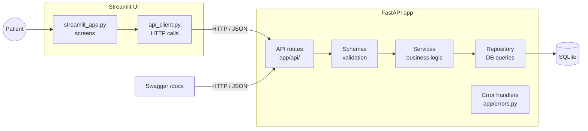

# PLAN.md – HealthTrack

> How HealthTrack is designed and the order it is built in.
> **What** to build is defined in REQUIREMENTS.md. Rules for building are in CLAUDE.md.

## 1. Approach

Clean layered architecture, built **feature by feature**: each slice delivers one complete feature end to end: **API + tests + its UI screen**. After every slice there is something working that can be seen and demoed.

Within each slice, the **API and its tests are built and committed first**, then the UI part. So the backend for the Must requirements is never held back by UI work.

## 2. Architecture

**Request flow example (logging a symptom):**
Patient fills the form → `api_client.py` sends `POST /patients/1/symptoms` → route receives it → Pydantic schema validates it (422 if invalid) → service applies the logic → repository saves it → 201 with the saved record → UI shows "Saved".

| Layer | File(s) | Responsibility |
|---|---|---|
| UI screens | `ui/streamlit_app.py` | Forms, tables, insights display |
| UI API client | `ui/api_client.py` | All HTTP calls; turns API errors and "API down" into friendly messages |
| API routes | `app/api/symptoms.py`, `app/api/insights.py` | Receive request, call service, return response |
| Schemas | `app/schemas.py` | Validate input, shape output |
| Services | `app/services/symptom_service.py`, `app/services/insights_service.py` | Business logic (date rules, counting, averages) |
| Repository | `app/repository.py` | Read/write the database |
| Errors | `app/errors.py` | One error format; DB failure → 500 |
| Config / DB | `app/config.py`, `app/db.py`, `app/models.py` | Settings, connection, table |

## 3. Data model

One table: **symptoms**

| Column | Type | Notes |
|---|---|---|
| `id` | integer, primary key | Auto-generated |
| `patient_id` | integer | Identifies the patient (no auth, see A1) |
| `symptom` | text (max 100) | Short name, used for insights |
| `notes` | text (max 2,000), nullable | Optional details |
| `date` | date | Day the symptom happened |
| `severity` | integer | 1–5, validated in the schema + database check constraint |
| `created_at` | datetime | Set automatically |

Index on (`patient_id`, `date`) for fast date-range queries.

## 4. API endpoints

| Method & path | Purpose | FR | Success | Errors |
|---|---|---|---|---|
| `POST /patients/{patient_id}/symptoms` | Log a symptom | FR-01, FR-03 | 201 + created record | 422, 500 |
| `GET /patients/{patient_id}/symptoms?start_date&end_date` | List symptoms in a range, newest first | FR-02 | 200 + list | 422, 500 |
| `GET /patients/{patient_id}/insights?start_date&end_date` | Most frequent symptom(s) + average severity | FR-04 | 200 + insights | 422, 500 |

Full request/response examples are in REQUIREMENTS.md and in the auto-generated docs at `/docs`.

## 5. Error handling design (FR-05)

- `app/errors.py` registers exception handlers that turn every error into `{"error": {"code", "message", "details"}}`.
- `SQLAlchemyError` → 500 `database_error`; `RequestValidationError` → 422 `validation_error`; 404/405 mapped; anything else → 500 `internal_error`.
- Real errors are logged on the server; users never see stack traces or SQL.
- Writes run in a transaction and roll back on failure.
- `ui/api_client.py` shows the API's error message, or "Cannot reach the HealthTrack API. Is it running?" if the API is down.

## 6. Key decisions and trade-offs

| Decision | Why | Trade-off |
|---|---|---|
| FastAPI | Built-in validation (Pydantic) and auto-generated API docs | Must learn its basics |
| SQLite | Zero setup, one file | Not for many simultaneous users; production would use PostgreSQL |
| Layered structure | Each part has one job, is testable alone, and easy to explain | More files than a single-file app |
| Feature-by-feature slices | Working, demo-able feature after each slice; UI polish builds up | Each slice is longer; UI work starts before all features exist |
| API first inside each slice | Backend for Musts is done and committed before UI work | Slightly more commits per slice (a good thing for Git hygiene) |
| `ui/api_client.py` | Keeps HTTP and error handling out of screen code | One extra file |
| Separate `symptom` and `notes` | Detailed notes without breaking frequency counts | Patient fills two fields |
| UI calls the API, never the DB | Validation lives in one place | UI needs the API running |
| Insights computed on request | Always up to date, simple | Slower for very large data (fine here) |

## 7. Slices (build order)

Each slice: **API tests → API code → `pytest` + `ruff` → commit → UI part → check in browser → commit → update REQUIREMENTS.md**.

| # | Slice | Covers | Done when | Est. |
|---|---|---|---|---|
| 0 | Setup | – | Folder structure, `requirements.txt`, `.gitignore`, `.env.example`, DB connection, empty API and UI both start, `pytest` + `ruff` run | 40 min |
| 1 | Log a symptom | FR-01, FR-03, FR-06 (form) | POST works; all validation edge cases tested; UI form saves and shows success or field errors | 1.5 h |
| 2 | View symptoms | FR-02, FR-06 (table) | GET with date filter works; range edge cases tested; UI table with date filter and "no results" message | 1.5 h |
| 3 | Insights | FR-04, FR-06 (insights view) | Insights endpoint works; ties, empty period, mixed case tested; UI insights section | 1.25 h |
| 4 | Error handling | FR-05, FR-06 (error messages) | Standard error format everywhere; DB failure test returns 500; UI handles API down | 45 min |
| 5 | Finish | All | README complete, `/docs` checked, all tests green, `ruff` clean | 45 min |

**All Musts are done after slice 2.**

**If time runs short:** finish the API part of slices 3 and 4 first and keep their UI parts minimal. Never skip the API work for FR-04/FR-05 to polish the UI.

## 8. Testing strategy

- `tests/conftest.py` creates the app with a **separate test database** for each test.
- Test files: `test_symptoms.py` (FR-01, FR-02), `test_validation.py` (FR-03), `test_insights.py` (FR-04), `test_errors.py` (FR-05).
- Every edge case in REQUIREMENTS.md has a test; test names include the FR, e.g. `test_fr03_rejects_whitespace_only_symptom`.
- DB failure is simulated by overriding the `get_db` dependency to raise `SQLAlchemyError`.
- UI is checked by hand in the browser after each slice (automated UI tests are optional).
