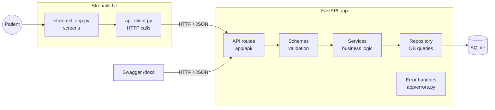

# HealthTrack

HealthTrack is a patient symptom tracker. Patients log daily symptoms with a date and a severity from 1 to 5, view their entries for a date range, and see simple insights: their most frequent symptom(s) and average severity.
It is a **FastAPI** REST API with a **SQLite** database, plus an optional **Streamlit** web UI that talks to the API.

---

## Setup and run

Requires **Python 3.11+**. Run these commands from the project folder.

```bash
# 1. Create and activate a virtual environment
python -m venv .venv
source .venv/bin/activate          # Windows: .venv\Scripts\activate

# 2. Install the dependencies
pip install -r requirements.txt

# 3. Enable the pre-commit checks (one time; runs pytest + ruff before every commit)
git config core.hooksPath hooks
```

Run each part in its own terminal, with the virtual environment activated in each:

```bash
# API: http://localhost:8000 (interactive docs at http://localhost:8000/docs)
uvicorn app.main:app --reload

# UI: http://localhost:8501 (needs the API running)
streamlit run ui/streamlit_app.py

# Tests and code checks
pytest
ruff check .
ruff format --check .
```

> Run Streamlit from the `.venv` (check with `which streamlit`). An older Streamlit installed elsewhere, for example by Anaconda, can render the charts differently.

**Settings** (optional) come from environment variables; see [`.env.example`](.env.example).

| Variable | Default | Used by |
|---|---|---|
| `DATABASE_URL` | `sqlite:///./healthtrack.db` | API |
| `HEALTHTRACK_API_URL` | `http://localhost:8000` | UI |

The database file and its table are created automatically when the API starts.

---

## API overview

Full interactive documentation, with every field, example and error response: **http://localhost:8000/docs**

| Method | Endpoint | Purpose |
|---|---|---|
| `POST` | `/patients/{patient_id}/symptoms` | Log a symptom |
| `GET` | `/patients/{patient_id}/symptoms?start_date=&end_date=` | List a patient's symptoms, newest first |
| `GET` | `/patients/{patient_id}/insights?start_date=&end_date=` | Most frequent symptom(s) and average severity |

Dates use `YYYY-MM-DD`. Both date filters are optional and **inclusive**.

### Log a symptom
```http
POST /patients/1/symptoms
Content-Type: application/json

{ "symptom": "Headache", "notes": "Started in the morning, eased after rest.", "date": "2026-11-02", "severity": 3 }
```
`201 Created`
```json
{ "id": 1, "patient_id": 1, "symptom": "Headache", "notes": "Started in the morning, eased after rest.",
  "date": "2026-11-02", "severity": 3, "created_at": "2026-11-02T14:05:00Z" }
```

### List symptoms for a date range
```http
GET /patients/1/symptoms?start_date=2026-11-01&end_date=2026-11-07
```
`200 OK`: a list, newest first, or `[]` if there are none
```json
[ { "id": 1, "patient_id": 1, "symptom": "Headache", "notes": "Started in the morning, eased after rest.",
    "date": "2026-11-02", "severity": 3, "created_at": "2026-11-02T14:05:00Z" } ]
```

### Insights for a period
```http
GET /patients/1/insights?start_date=2026-11-01&end_date=2026-11-07
```
`200 OK`
```json
{ "patient_id": 1, "start_date": "2026-11-01", "end_date": "2026-11-07", "total_entries": 5,
  "most_frequent_symptoms": [ { "symptom": "headache", "count": 3, "average_severity": 3.0 } ],
  "overall_average_severity": 3.4 }
```
Each most frequent symptom has its own `average_severity`. `overall_average_severity` covers **all** entries in the period.

### Errors
Every error uses the same format. Validation errors list each problem:
```json
{ "error": { "code": "validation_error", "message": "Invalid input.",
  "details": [ { "field": "severity", "message": "severity must be between 1 and 5" } ] } }
```

| Status | `code` | When |
|---|---|---|
| 422 | `validation_error` | Invalid body, path or query input, or malformed JSON |
| 404 | `not_found` | Unknown URL |
| 405 | `method_not_allowed` | Wrong HTTP method |
| 500 | `database_error` | The database can't be used |
| 500 | `internal_error` | Any other unexpected error |

---

## Architecture



| Layer | Files | Responsibility |
|---|---|---|
| UI screens | `ui/streamlit_app.py` | Forms, symptom cards, insights and charts; no HTTP or database code |
| UI API client | `ui/api_client.py` | The only place that calls the API; turns every failure into a friendly message |
| API routes | `app/api/` | Receive a request, call a service, return the response |
| Schemas | `app/schemas.py` | All validation rules and the request/response shapes |
| Services | `app/services/` | Business logic: logging, filtering and insights (counting, averages, rounding) |
| Repository | `app/repository.py` | Database reads and writes only, through SQLAlchemy |
| Errors | `app/errors.py` | One error format; maps validation, 404, 405, database and unexpected errors |
| Config / DB | `app/config.py`, `app/db.py`, `app/models.py` | Settings from environment variables, database session, the `symptoms` table |

Tests (`tests/`) use a separate in-memory database for every test and never touch the real one. A database failure is simulated by replacing the database dependency.

---

## Key decisions and trade-offs

| Decision | Why | Trade-off |
|---|---|---|
| FastAPI + Pydantic | Validation and interactive docs come built in | Framework to learn |
| SQLite | No setup, one file | Not for many users at once; production would use PostgreSQL |
| Layered structure | Each part has one job and is easy to test and explain | More files than a single-file app |
| Separate `symptom` (max 100) and `notes` (max 2,000) | Patients can describe symptoms in detail without breaking "most frequent" counting | Two fields to fill in |
| Symptoms grouped by trimmed, lowercase name | Simple and predictable | No spelling correction or synonyms |
| Ties return every tied symptom | Fairer than picking one | A list instead of one value |
| Future dates rejected | A symptom can't happen in the future | — |
| `patient_id` limited to 1–2,147,483,647 | Fits a standard 32-bit INTEGER in any database; huge IDs get a clear 422 instead of a crash | — |
| UI talks only to the API | Validation lives in one place | The API must be running |
| Insights computed on request | Always up to date | Slower on very large data (fine here) |
| No pagination on the symptom list | Simple | A patient with years of entries gets them all at once |

---

## Edge cases handled

- Empty or whitespace-only symptom, missing fields, symptom over 100 or notes over 2,000 characters → `422` with a clear message per field; all problems are listed at once
- Severity outside 1–5, or not a whole number (`2.5`, `"3"`, `true`, `null`) → `422`
- Invalid date (`2026-13-45`, `yesterday`) or a future date → `422`
- `start_date` after `end_date` → `422`; only one date, or none, works as an open-ended range
- `patient_id` that is 0, negative, not a number or above 2,147,483,647 → `422`
- Spaces around `symptom` and `notes` are trimmed; empty notes are stored as `null`; unknown extra fields are ignored
- No entries, or a patient who never logged anything → `200` with `[]`, or insights with `total_entries: 0`
- "Headache", "headache" and " HEADACHE " count as the same symptom in insights
- Database failure → `500 database_error`, with no SQL or stack trace shown and nothing half-saved
- UI: API down, too slow, or returning something unexpected → a friendly message, never a traceback

---

## Out of scope and known limitations

**Out of scope** (as the brief says)
- No login or authorization: anyone who knows a patient ID can read that patient's data.
- No deployment: the app runs locally.
- No machine learning: insights are simple statistics.

**Known limitations**
- SQLite is meant for a single local user, not many people at once.
- The symptom list has no pagination.
- Symptom matching ignores only case and spaces; "Head ache" and "Migraine" count as different symptoms.
- The UI shows symptom names in one format (e.g. "Headache"), so abbreviations look like "Covid-19". The stored text is unchanged.
- The daily severity chart shows the most recent 14 days that have entries, evenly spaced, so the distance between points doesn't reflect the time between them.
- On a `405` response, the `Allow` header lists only one of the allowed methods (a FastAPI limitation).
- The UI is checked by hand; only the API has automated tests.

---

## AI usage


- **Claude Code (VS Code extension):** Wrote most of the application's implementation code and automated tests, following the project specifications and instructions I provided. It also assisted with debugging and improving the implementation.

### How I Worked With AI

- I established project-specific guidelines in `CLAUDE.md`, defining the layered architecture, coding standards, testing approach, Git workflow and rules for introducing dependencies or changing requirements.
- I followed a specification-driven, slice-by-slice development approach, implementing and verifying one feature at a time rather than generating the entire application at once.
- I reviewed the code generated by Claude Code by reading the relevant files, understanding the implementation and tracing how different components interact, from frontend requests through API endpoints, validation, business logic and database operations.
- I reviewed the implementation against the original requirements and examined edge cases, invalid inputs, database failures and unexpected API responses.
- I ran the automated test suite (`pytest`), checked code quality using Ruff, tested API endpoints through Swagger UI and manually checked the Streamlit application.
- I examined code changes before accepting them, questioned implementation decisions when necessary, and requested changes whenever the behaviour did not match the expected requirements.
- I maintained meaningful Git commits throughout development and reviewed the changes before committing and pushing them to the public repository.

### What I Verified and Improved

The following are some important examples of decisions, issues and improvements made during development. Further details are documented in `AI-LOG.md`.

- **Data Model:** The initial design used a single short `description` field. I reviewed the data requirements and identified the need to capture more detailed patient information. I pushed for separate `symptom` and `notes` fields.
- **Future Dates:** While testing the symptom form, I identified that a future date was silently being saved as today's date. I ensured date validation was handled consistently by the API.
- **Large Patient IDs:** During edge-case testing, I identified that extremely large patient IDs could cause database errors. I chose a maximum limit of `2,147,483,647` and verified that oversized IDs return a proper 422 validation response instead of causing a server failure.
- **Insights Calculation:** While reviewing the insights implementation, I noticed that the overall average looked like it belonged to symptoms with tied frequencies. I refined the output to provide individual average severity values and clearly named the overall metric as `overall_average_severity`.
- **UI and User Experience:** During review and testing, I identified a misleading empty-results message, an unsuitable table layout for long patient notes, inconsistent symptom naming across screens and a confusing severity chart. I opted for cards with a **"View notes"** button instead of a checkbox-based table, and improved the clarity and consistency of the interface.
- **Error Handling:** I verified how the application handles database failures, invalid requests, malformed API responses, timeouts and unexpected errors. I ensured that users receive understandable error messages without exposing internal tracebacks or sensitive technical information.

Claude Code generated most of the implementation and tests, but I guided the development through project specifications, reviewed the generated code, evaluated technical decisions, tested functionality and approved the changes. I took responsibility for understanding and verifying the final implementation.